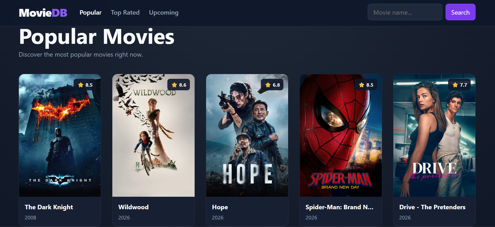
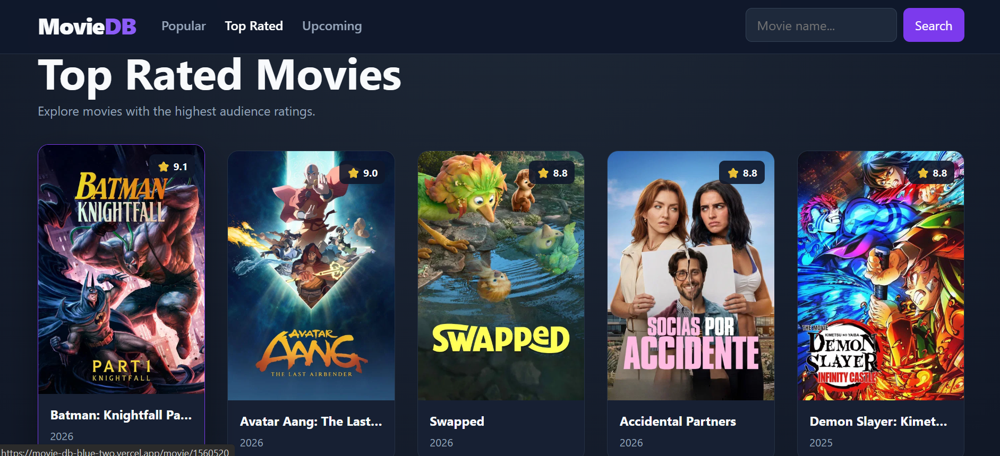
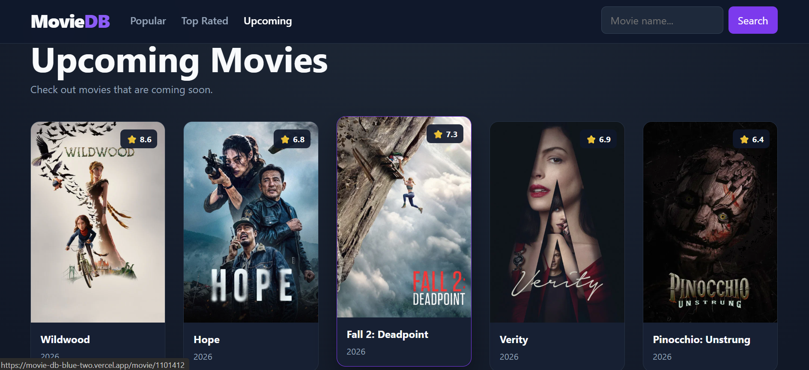
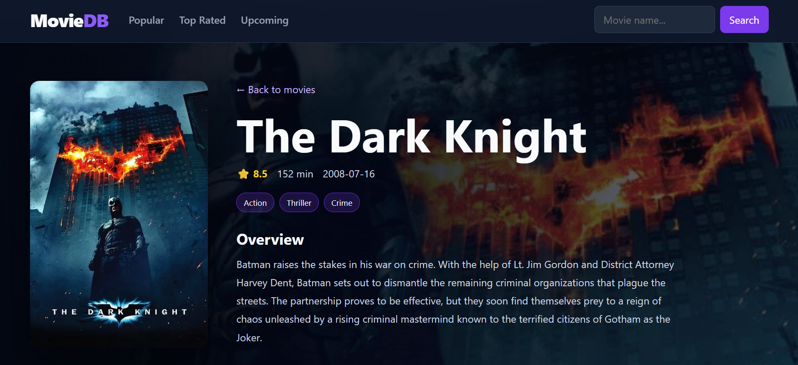
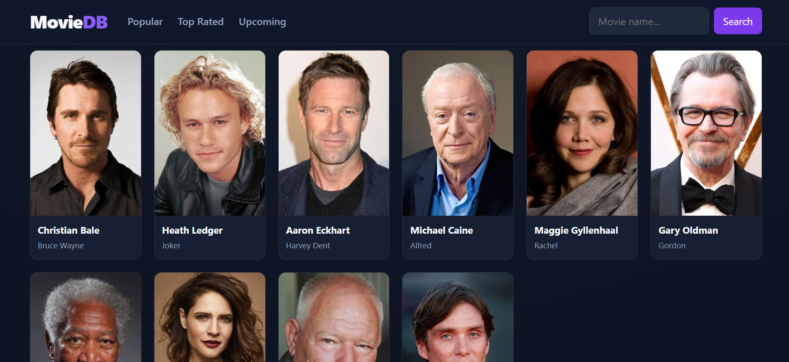

# 🎬 MovieDB – React Movie Discovery Application

A modern movie discovery web application built with **React.js** that allows users to browse popular, top-rated, and upcoming movies, search for movies, and explore detailed movie information through a clean and responsive interface.

## 📌 Project Overview

MovieDB is a React-based movie discovery application designed to make it easy for users to explore movie content through different categories. The application provides dedicated views for **Popular Movies**, **Top Rated Movies**, and **Upcoming Movies**, along with a search interface for finding movies by name.

The application also provides a detailed movie view with information such as rating, runtime, release date, genres, overview, and cast information. The project demonstrates practical frontend development skills including component-based UI development, API-driven data rendering, navigation, search handling, responsive layouts, and deployment with Vercel.

---

## ✨ Features

- 🎬 Browse **Popular Movies**
- ⭐ Explore **Top Rated Movies**
- 🗓️ Discover **Upcoming Movies**
- 🔍 Search movies by name
- 🎞️ Open individual movie details
- ⭐ Display movie ratings
- ⏱️ Display movie runtime
- 📅 Display release date
- 🏷️ Display movie genres
- 📝 Display movie overview
- 👥 Display movie cast information
- 🧭 Navigation between movie categories
- 📱 Responsive movie-card layout
- 🌐 Dynamic movie data from an external movie API
- 🚀 Deployed on Vercel

---

## 🖥️ Live Demo

### 🚀 [View MovieDB Live](https://movie-db-blue-two.vercel.app/)

---

## 📸 Screenshots

### Popular Movies



### Top Rated Movies



### Upcoming Movies



### Movie Details



### Movie Cast



> Keep the `screenshots` folder in the repository root so the image paths above work correctly.

---

## 🛠️ Tech Stack

| Technology | Purpose |
|------------|---------|
| **React.js** | Building the interactive user interface |
| **JavaScript** | Application logic and data handling |
| **HTML5** | Application structure |
| **CSS3** | Styling and responsive layout |
| **Movie API** | Fetching dynamic movie information |
| **Git & GitHub** | Version control and source-code management |
| **Vercel** | Production deployment |

> Add **Vite** to the table if it is used in the project.

---

## 🏗️ Project Architecture

The application follows a frontend API-driven architecture:

```text
                    User
                      │
                      ▼
              React Application
                      │
                      ▼
             React Components
                      │
                      ▼
                API Request
                      │
                      ▼
                 Movie API
                      │
                      ▼
                JSON Response
                      │
                      ▼
             React State / Data
                      │
                      ▼
               UI Rendering
                      │
                      ▼
                    User
```

### Architecture Explanation

1. The user interacts with the React application.
2. React renders the required components and movie sections.
3. The application sends requests to the external movie API.
4. The API returns movie information as JSON data.
5. The application processes the received data.
6. React uses the data to render movie cards and detailed movie information.
7. User interactions such as navigation, search, and movie selection update the displayed content.

---

## 🔄 Application Flow

```text
Open Application
       ↓
React Loads UI
       ↓
Select Movie Category / Search
       ↓
API Request
       ↓
Movie API Response
       ↓
Process Movie Data
       ↓
Render Movie Cards
       ↓
Select a Movie
       ↓
Movie Details Page
       ↓
Display Details + Cast
```

### User Flow

1. The user opens the MovieDB application.
2. The application displays the available movie categories.
3. The user can browse **Popular**, **Top Rated**, or **Upcoming** movies.
4. The user can search for a movie using the search field.
5. Movie cards display poster, title, release year, and rating.
6. Selecting a movie opens its detailed information.
7. The details view presents the movie poster, rating, runtime, release date, genres, overview, and cast information.

---

## 🔌 API Integration

The application retrieves movie information from an external movie API.

The general request flow is:

```text
React Component
      ↓
HTTP Request
      ↓
Movie API
      ↓
JSON Response
      ↓
React Data Handling
      ↓
Movie UI
```

The API response is used to dynamically populate movie listings and detailed movie information.

### API Provider

**Update this section with the exact API provider used by the project.**

For example, if the project uses TMDB:

```text
The Movie Database (TMDB) API
```

Do not expose any private API key or token in the README or source repository.

---

## 📂 Project Structure

A typical React structure for this application may look like:

```text
MovieDB/
│
├── public/
│
├── src/
│   ├── assets/
│   ├── components/
│   ├── pages/
│   ├── services/
│   ├── App.jsx
│   ├── main.jsx
│   └── ...
│
├── screenshots/
│   ├── popular-movies.png
│   ├── top-rated-movies.png
│   ├── upcoming-movies.png
│   ├── movie-details.png
│   └── movie-cast.png
│
├── .env
├── .gitignore
├── package.json
└── README.md
```

> Update the `src` structure to match your actual repository files.

---

## ⚙️ Installation & Setup

### 1. Clone the Repository

```bash
git clone YOUR_GITHUB_REPOSITORY_URL
```

### 2. Navigate to the Project

```bash
cd YOUR_PROJECT_FOLDER
```

### 3. Install Dependencies

```bash
npm install
```

### 4. Configure Environment Variables

If the project uses an API key, create a `.env` file in the project root.

Example:

```env
VITE_API_KEY=your_api_key_here
```

Use the exact environment-variable name required by your project.

### 5. Start the Development Server

```bash
npm run dev
```

### 6. Open the Application

For a typical Vite application:

```text
http://localhost:5173
```

---

## 🔐 Environment Variables

Keep API credentials outside the source code.

Example:

```env
VITE_API_KEY=your_api_key_here
```

### Security Best Practices

- Never commit real API keys to GitHub.
- Add `.env` to `.gitignore`.
- Create a `.env.example` file containing placeholder values.
- Configure production environment variables through Vercel.
- Never expose private credentials inside frontend source files.

Example `.env.example`:

```env
VITE_API_KEY=your_api_key_here
```

---

## 🚀 Deployment

The application is deployed using **Vercel**.

### Deployment Steps

1. Push the project to GitHub.
2. Sign in to Vercel.
3. Import the GitHub repository.
4. Configure the required environment variables.
5. Build and deploy the application.
6. Vercel provides the production URL.

### Production URL

https://movie-db-blue-two.vercel.app/

---

## 🎯 Key Learning Outcomes

This project demonstrates practical experience with:

- React.js
- JavaScript
- Component-based architecture
- API integration
- Asynchronous data handling
- Dynamic rendering
- State management
- Search functionality
- Navigation
- Conditional rendering
- Responsive UI development
- Environment variables
- Git and GitHub
- Vercel deployment

---

## 🧠 Technical Concepts Demonstrated

- React Components
- React Props
- React State
- React Hooks
- `useState`
- `useEffect`
- API Requests
- Promises
- Async/Await
- JSON Data
- Event Handling
- Conditional Rendering
- List Rendering
- Dynamic Routing/Navigation
- Responsive Design
- Environment Variables

> Remove any concept that is not present in the actual source code.

---

## 📈 Future Improvements

Possible improvements for future versions:

- ❤️ Add a personal watchlist/favorites feature
- 🔐 Add user authentication
- 🎬 Add movie trailer integration
- 🔎 Add advanced filtering
- 📄 Add pagination or infinite scrolling
- 🌙 Add dark/light theme controls
- ⚡ Improve loading and error states
- 📱 Further optimize the mobile experience
- 📊 Add additional movie statistics
- 🚀 Improve performance and API caching

---

## 🐛 Known Issues

No major known issues have been documented in this README.

> Update this section if the project currently has known bugs or limitations.

---

## 🤝 Contributing

Contributions and improvements are welcome.

### How to Contribute

1. Fork the repository.
2. Create a feature branch:

```bash
git checkout -b feature/your-feature-name
```

3. Make your changes.
4. Commit your changes:

```bash
git commit -m "Add: your feature description"
```

5. Push the branch:

```bash
git push origin feature/your-feature-name
```

6. Open a Pull Request.

---

## 📄 License

This project can be distributed under the MIT License.

If an MIT `LICENSE` file has not yet been added to the repository, add one before presenting the project as officially licensed under MIT.

---

## 👨‍💻 Author

### Tanishq Abhi

**Aspiring Software Developer**

Focused on building modern web applications and developing practical skills in React.js, JavaScript, Python, SQL, and full-stack development.

| Platform | Link |
|----------|------|
| GitHub | [TanishqAbhi](https://github.com/TanishqAbhi) |
| Portfolio | [Portfolio](https://tanishqabhi.github.io/Portfolio/) |
| LinkedIn | [LinkedIn](https://www.linkedin.com/in/mattam-tanishq-abhilash-shastri-68997b372/) |

---

## ⭐ Show Your Support

If you found this project useful or interesting, consider giving the repository a ⭐ on GitHub.

Your feedback and suggestions are always welcome.

---

## 🔗 Project Links

- 🌐 **Live Demo:** https://movie-db-blue-two.vercel.app/
- 💻 **GitHub:** https://github.com/TanishqAbhi
- 👨‍💻 **Portfolio:** https://tanishqabhi.github.io/Portfolio/
- 🔗 **LinkedIn:** https://www.linkedin.com/in/mattam-tanishq-abhilash-shastri-68997b372/
